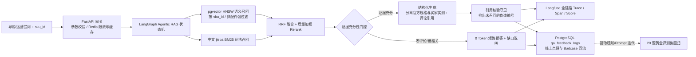

# 跨境电商生产级 Agentic RAG 商品与评论知识问答平台 (`ecom-agentic-rag`)

> 聚焦**跨境电商宠物用品**垂直场景，面向售前导购与选品运营，解决商品详情页无法覆盖的真实使用体验问答（卧室噪音实测、洗碗机耐温、2.4GHz 配网坑、大颗粒冻干卡粮、猫砂限制、配件兼容性等）。  
> 完整实现 **数据治理 → 混合检索与重排 → LangGraph 证据门控与引用核验 → 20 题黄金集自动化对比评测 → Redis 缓存限流 → Langfuse 全链路可观测 → Badcase 反馈与迭代闭环**。

## 架构总览



## 实测量化对比（DashScope `text-embedding-v3` + DeepSeek `deepseek-chat` + `pgvector 0.8.7`）

完整评测脚本见 [`evals/run_eval.py`](evals/run_eval.py)，原始结果见 [`evals/reports/v1_vs_v2_report.md`](evals/reports/v1_vs_v2_report.md)，Badcase 深度复盘见 [`docs/badcase_iteration_log.md`](docs/badcase_iteration_log.md)。

| 指标维度 | V1 纯向量基线 | V2 Agentic 混合检索 | 实际变化 |
| :--- | :---: | :---: | :---: |
| **SKU 召回纯净度（防串品）** | 44.0% | **100.0%** | **+56.0 pp** |
| **跨型号/配件污染率（越低越好）** | 100.0% | **0.0%** | **-100.0 pp** |
| **必需评论 Recall@5** | 96.9% | **100.0%** | **+3.1 pp** |
| **拒答边界准确率** | 85.0% | **100.0%** | **+15.0 pp** |
| **引用合法率（无伪造编号）** | 100.0% | **100.0%** | 零伪造 |
| **忠实度 Faithfulness (Judge)** | 0.930 | **0.995** | **+0.065** |
| **答案相关性 Answer Relevancy** | 0.953 | **0.983** | **+0.030** |
| **拒答场景延迟（Q13–Q15）** | 1149–2090 ms | **238–492 ms（0 Token）** | **降延 ~75%，省 100% LLM 成本** |
| **热点问答缓存命中（Redis）** | 4757 ms（冷请求） | **30 ms（热缓存）** | **降延 99.4%，0 Token** |

## 目录结构

- `docker/`：Linux 虚拟机 Docker Compose 编排（PostgreSQL 16 + `pgvector`、Redis 7、Langfuse v2）与建表脚本 `init.sql`
- `data/raw/`：跨境宠物用品主数据（含配件干扰项与零评论边界商品）与评论原始数据集（含短评、纯物流水评、重复评论）
- `src/ecom_rag/`：核心源码
  - `governance.py`：文本归一化、低质/纯物流过滤、SHA-256 去重、综合质量评分、单 SKU 上限控制与切片
  - `db.py` & `ingest.py`：幂等入库与失效切片逻辑软删除 CLI
  - `retriever.py`：V1 纯向量基线 vs V2 强元数据过滤 + BM25/pgvector RRF 质量重排
  - `graph.py`：LangGraph 检索 → 证据门控 → 拒答/生成 → 引用核验状态机
  - `cache.py`、`observability.py`、`api.py`：FastAPI 网关、Redis 限流/缓存、Langfuse Trace/Score 上报与 Badcase 回流
- `evals/`：20 题黄金评测集与 V1/V2 自动化回归脚本
- `scripts/verify_e2e_live.py`：端到端实测验证脚本
- `tests/`：数据治理与 RAG 状态机离线单元测试（8/8 通过）
- `docs/badcase_iteration_log.md`：真实 Badcase 复盘与 V2.1 迭代计划

## 快速启动

```bash
# 1. 在 Linux 虚拟机启动 PostgreSQL(pgvector) + Redis + Langfuse
cd docker && docker compose --profile observability up -d

# 2. 本地准备 Python 3.12 环境与配置
uv venv --python 3.12 .venv
uv pip install --python .venv/Scripts/python.exe -e ".[dev]"
cp .env.example .env   # 填入虚拟机 IP、LLM/Embedding Key 与 Langfuse Key

# 3. 执行数据治理与向量入库
.venv/Scripts/python.exe -m ecom_rag.ingest

# 4. 启动 FastAPI 服务（启动后浏览器访问 http://127.0.0.1:8000 打开纯中文前端工作台）
.venv/Scripts/uvicorn.exe ecom_rag.api:app --reload --port 8000

# 5. 运行单元测试与 V1 vs V2 黄金评测集回归
.venv/Scripts/pytest.exe -v
.venv/Scripts/python.exe evals/run_eval.py --record-db
```
